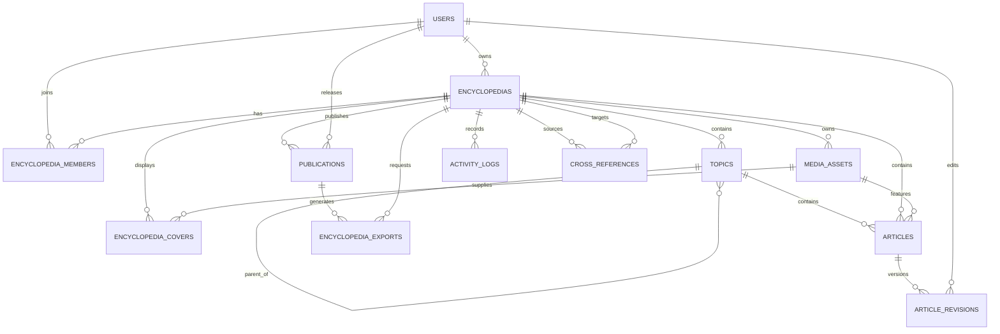

# 03 — Data Model

PostgreSQL is the system of record. All tables use `bigint` identity primary keys,
`timestamps`, and snake_case. JSONB is used only for structured documents (editor content,
theme settings, snapshots, export options) — never for relationships.

Reference: `Docs/development/mermaid-database-architecture-diagram.png`.

## 1. Entity relationship diagram

## 2. Tables

### users (starter kit, extended)
| Column | Type | Notes |
| --- | --- | --- |
| id | bigint PK | |
| name | string | |
| email | string unique | |
| password | string | hashed |
| is_platform_admin | boolean default false | gate bypass for platform operations |
| email_verified_at, two_factor_* | starter kit | |

### encyclopedias
| Column | Type | Notes |
| --- | --- | --- |
| id | bigint PK | |
| owner_id | FK users | cascade restrict on delete |
| title | string(160) | |
| slug | string(120) unique | reserved-word validated |
| subtitle | string(240) null | |
| description | text null | |
| language | string(8) default `en` | BCP-47-ish |
| visibility | enum `private`,`unlisted`,`public` | default private |
| status | enum `draft`,`published`,`archived` | default draft |
| theme_key | string(40) | registry key |
| theme_version | string(20) | pinned theme code version |
| theme_settings | jsonb | validated per theme |
| cover_style | enum `hero`,`editorial`,`cards` | default hero |
| export_enabled | boolean default true | reader downloads |
| published_at | timestamp null | |
| deleted_at | timestamp null | soft delete |

Indexes: `(owner_id)`, `(status, visibility)`, `(published_at)`.

### encyclopedia_members
`id`, `encyclopedia_id` FK cascade, `user_id` FK cascade, `role` enum `editor`,`author`,
timestamps. Unique `(encyclopedia_id, user_id)`. Owner is implicit and not duplicated here.

### media_assets
| Column | Type | Notes |
| --- | --- | --- |
| id | bigint PK | |
| encyclopedia_id | FK cascade | tenant boundary |
| uploaded_by | FK users null | |
| disk | string(40) | `public` / `s3` |
| path | string(500) | generated name, never user filename |
| filename | string(255) | original name for display only |
| mime_type | string(100) | `image/*` allow-list |
| size | unsigned bigint | bytes |
| width, height | unsigned int null | |
| alt_text | string(300) null | |
| caption | string(500) null | |
| checksum | string(64) | sha-256 for dedupe |
| timestamps | | |

Unique `(encyclopedia_id, checksum)`. Index `(encyclopedia_id)`.
Deleting a media asset referenced by a cover is blocked at application level; articles keep
their rendered reference guard (see §5).

### encyclopedia_covers
`id`, `encyclopedia_id` FK cascade, `media_asset_id` FK restrict, `position` smallint,
`caption` string(300) null, `alt_text` string(300) null, timestamps.

Constraints:
- `CHECK (position BETWEEN 1 AND 3)`
- `UNIQUE (encyclopedia_id, position)`
- `UNIQUE (encyclopedia_id, media_asset_id)`

These enforce the three-cover rule in the database, not only in the UI.

### topics
`id`, `encyclopedia_id` FK cascade, `parent_id` FK topics null (null on delete),
`title` string(160), `slug` string(140), `description` text null,
`sort_order` unsigned int default 0, `status` enum `draft`,`published` default draft,
timestamps. Unique `(encyclopedia_id, slug)`. Index `(encyclopedia_id, parent_id, sort_order)`.

Invariant: `parent_id` must reference a root topic of the same encyclopedia (max depth 2).
Enforced in `TopicRequest` + model guard.

### articles
| Column | Type | Notes |
| --- | --- | --- |
| id | bigint PK | |
| encyclopedia_id | FK cascade | |
| topic_id | FK topics null (null on delete) | primary topic |
| title | string(200) | |
| slug | string(180) | unique per encyclopedia |
| excerpt | text null | search + cards |
| content | jsonb | Tiptap document |
| content_schema_version | smallint default 1 | migration hook |
| featured_image_id | FK media_assets null | restrict |
| status | enum `draft`,`in_review`,`published`,`archived` | |
| sort_order | unsigned int default 0 | |
| revision_number | unsigned int default 1 | optimistic lock |
| created_by, updated_by | FK users null | |
| published_at | timestamp null | |
| timestamps, deleted_at | | |

Indexes: `(encyclopedia_id, status)`, `(topic_id, sort_order)`,
`(encyclopedia_id, slug)` unique, FTS GIN on a generated vector (pgsql).

### article_revisions
`id`, `article_id` FK cascade, `editor_id` FK users null, `revision_number` unsigned int,
`title`, `excerpt`, `content` jsonb, `created_at`. Unique `(article_id, revision_number)`.

A revision is written on every explicit save/publish (not on autosave throttle ticks) and
before a restore. The latest revision mirrors the article's current content.

### publications
| Column | Type | Notes |
| --- | --- | --- |
| id | bigint PK | |
| encyclopedia_id | FK cascade | |
| version | unsigned int | unique per encyclopedia |
| snapshot_path | string(500) | immutable JSON on storage |
| theme_key, theme_version | string | pinned rendering contract |
| theme_settings | jsonb | snapshot of validated settings |
| topic_count, article_count | unsigned int | release stats |
| published_by | FK users null | |
| notes | string(500) null | release notes |
| published_at | timestamp | |

Unique `(encyclopedia_id, version)`.

### encyclopedia_exports
| Column | Type | Notes |
| --- | --- | --- |
| id | bigint PK | |
| encyclopedia_id | FK cascade | |
| publication_id | FK publications null | null for draft exports |
| requested_by | FK users null | null for reader-triggered generation |
| template_key, template_version | string | renderer inputs |
| renderer_version | string(20) | pipeline version |
| options | jsonb | include search/js/media, scope |
| status | enum `queued`,`processing`,`completed`,`failed` | |
| progress | tinyint 0–100 | |
| archive_path | string(500) null | |
| archive_size | unsigned bigint null | |
| checksum | string(64) null | sha-256 |
| cache_key | string(64) | artifact identity |
| error_message | text null | |
| started_at, completed_at | timestamp null | |
| timestamps | | |

Indexes: `(encyclopedia_id, created_at)`, `(cache_key, status)`, `(status)`.

### cross_references
Links an encyclopedia to a published article or topic in another published encyclopedia.

| Column | Type | Notes |
| --- | --- | --- |
| id | bigint PK | |
| source_encyclopedia_id | FK encyclopedias cascade | the work that displays the reference |
| target_encyclopedia_id | FK encyclopedias cascade | must be published and readable |
| target_type | enum `article`,`topic` | |
| target_id | bigint | app-validated; targets are therefore never trusted from the browser |
| note | string(300) null | optional editorial note |
| sort_order | unsigned int | display order |
| timestamps | | |

Unique `(source, target_encyclopedia, target_type, target_id)`. References are validated on
save (published target + published, readable target encyclopedia), pinned into publication
snapshots, and filtered again at render time. Stale targets are shown to editors as
unavailable and never rendered to readers.

### article_redirects
`id`, `encyclopedia_id` FK cascade, `from_slug` string, `to_article_id` FK cascade,
timestamps. Unique `(encyclopedia_id, from_slug)`. Used by the reader when a published slug
changes.

### activity_logs
`id`, `encyclopedia_id` FK cascade null, `user_id` FK null, `action` string(60),
`subject_type` string, `subject_id` bigint null, `meta` jsonb null, `created_at`.
Index `(encyclopedia_id, created_at)`.

## 3. Invariants

1. An encyclopedia's content belongs to exactly one encyclopedia (`encyclopedia_id` is
   present on every content table and never changed).
2. Slugs are unique within an encyclopedia, across topics **and** articles (a resolver picks
   the type; collisions are rejected at validation).
3. Topics are at most two levels deep.
4. Covers: 1–3 positions, unique per encyclopedia and media asset.
5. `articles.revision_number` increases monotonically; a stale write returns `409`.
6. A publication snapshot is write-once. Re-publishing creates a new version.
7. Exports reference either a publication or a draft of the same encyclopedia.
8. Deleting content never orphans exports: archives are stored standalone; the export row
   cascades with the encyclopedia, the archive file is removed by a listener.

## 4. Why JSONB for content

The editor document is a tree, not a set of relational rows. Storing it as JSONB:
- keeps a single authoritative representation (no lossy HTML round-trips);
- lets the same document render through any theme or future exporter;
- avoids an N-table schema for every block type;
- allows schema-version migrations to run over documents.

Search improves via a generated `tsvector` column rather than querying JSON ad hoc.

## 5. Referential behaviour for media

- `encyclopedia_covers.media_asset_id` and `articles.featured_image_id` use `RESTRICT`;
  a referenced asset cannot be deleted.
- Inline images in article JSON reference `mediaId`; the delete action scans article JSON for
  that id and refuses with a 422 listing blocking articles.
- Export collects media from covers, featured images and every `image`/`gallery` node.

## 6. Seeding

`DatabaseSeeder` creates:
- a platform admin and an editor account;
- “Ancient Civilizations” — published, Editorial, 3 covers, 5 topics, 7 rich articles,
  one release and a completed export;
- “Field Notes on Cartography” — draft, Modern Minimalist, 2 covers, 2 topics, 2 articles;
- “A Small Bestiary” — published, Contemporary Dark, 3 covers, 2 topics, 3 articles;
- “Atlas of Shared Waters” — published, Illustrated Atlas, 2 covers, 2 topics, 2 articles;
- “Dictionary of Forgotten Trades” — draft, Classic Reference, 1 cover, 2 articles.

The seeder is idempotent (`firstOrCreate` on slugs) so local resets are safe. Re-run
`php artisan queue:work --queue=exports` after seeding to materialise the demo archives.
