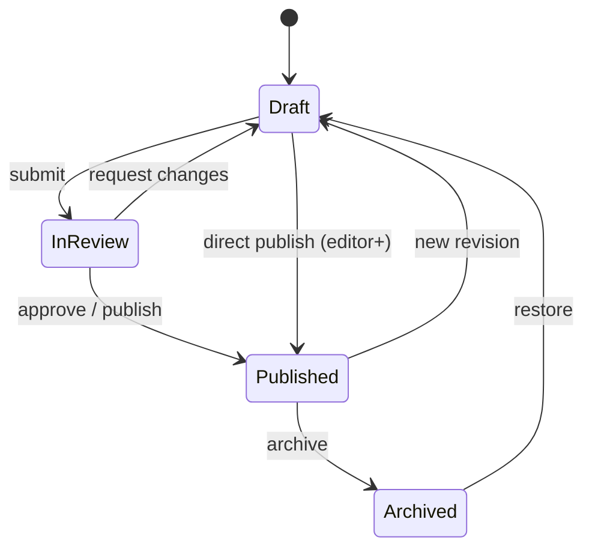

# 06 — Publishing and Static Export

## 1. Lifecycle



Two distinct concepts:

1. **Article status** — editorial state of a single article (`draft`, `in_review`,
   `published`, `archived`). Readers only see `published`.
2. **Encyclopedia publication** — an immutable, versioned release of the whole site
   (published articles + enabled topics + theme + settings).

Publishing the encyclopedia never changes article status. It captures the current published
set. Draft articles stay invisible.

## 2. Publication snapshot

`SnapshotBuilder::forRelease($encyclopedia, $user, $notes)` writes JSON to
`publications/{encyclopedia_id}/v{version}.json` on the `local` disk:

```json
{
  "snapshot_version": 1,
  "release": { "version": 3, "published_at": "...", "notes": "..." },
  "encyclopedia": { "title": "...", "slug": "...", "description": "...", "language": "en" },
  "theme": { "key": "editorial", "version": "1.0.0", "settings": { ... }, "cover_style": "hero" },
  "covers": [ { "media_id": 4, "path": "...", "alt": "...", "caption": "...", "position": 1 } ],
  "topics": [ { "id": 2, "slug": "...", "title": "...", "description": "...", "sort_order": 0, "children": [] } ],
  "articles": [
    {
      "id": 9, "topic_id": 2, "slug": "...", "title": "...", "excerpt": "...",
      "content": { "type": "doc", "content": [] },
      "content_schema_version": 1, "featured_media_id": 7,
      "published_at": "...", "author": "..."
    }
  ],
  "media": [ { "id": 4, "path": "...", "mime_type": "...", "alt": "...", "width": 1600, "height": 900 } ],
  "cross_references": [
    { "target_type": "article", "title": "...", "encyclopedia_title": "...", "url": "https://...", "note": "..." }
  ]
}
```

The snapshot is **write-once**. It contains source content, not rendered HTML, so a theme can
be re-applied and future exporters can reuse it.

## 3. Publishing action

`PublishEncyclopedia`:
1. Authorizes `publish` on the encyclopedia.
2. Validates readiness (≥1 published article; theme resolvable; no broken media refs).
3. Opens a transaction: locks the encyclopedia row, computes version + 1, builds snapshot,
   inserts `publications`, updates encyclopedia status/published_at/last release cache key.
4. After commit: records activity; dispatches a **public archive** export on the `exports`
   queue using the new publication.

Failure before commit leaves no version gap visible; a failed export does not unpublish the
site. The Publishing screen shows release + archive status separately.

## 4. Export artifact model

```
Export identity = sha256(
  publication_id | draft-revision-fingerprint
  + theme_key + theme_version
  + renderer_version
  + normalized(options)
)
```

| Option | Default | Effect |
| --- | --- | --- |
| `source` | `release` \| `draft` | Draft only for members with export permission |
| `include_search` | true | Adds search page, index and JS |
| `include_javascript` | true | Carousel/nav/search behaviours |
| `include_media` | true | Copies referenced media (required for offline) |
| `include_sitemap` | true | sitemap.xml + robots.txt |

If a completed export with the same key exists, `RequestExport` returns it (idempotent) and
the UI offers immediate download. This is the reader path as well.

## 5. Export pipeline

```
queued (exports queue)
  → processing (10%)
  → load snapshot / draft
  → build SiteBuilder context (15%)
  → render pages (home, topics, articles, search, 404) (40%)
  → write css/js/search index/sitemap/readme (55%)
  → collect + copy media (70%)
  → rewrite links and validate (80%)
  → zip + checksum + size (90%)
  → completed (100%)
  → on failure: failed + error_message, archive removed
```

### Directory layout
```
{slug}/
├── index.html
├── 404.html
├── topics/{topic-slug}/index.html
├── articles/{article-slug}/index.html
├── search/index.html
├── assets/
│   ├── css/style.css
│   ├── js/app.js
│   ├── js/carousel.js
│   ├── js/search.js
│   ├── images/{media-id}-{slug}.{ext}
│   └── search/search-index.js
├── sitemap.xml
├── robots.txt
└── README.txt
```

Paths are relative and depth-aware; every page receives `assetBase` (`../../`).

### Rendering parity
The exporter calls the same Blade theme views as the reader with `static = true` and an
`assetBase`. It does **not** maintain a second HTML template. The only divergence is link and
asset URL rewriting.

### Media handling
- Scan covers, featured images and `image`/`gallery` nodes.
- Copy referenced files only; generate safe names `{id}-{slug}.{ext}`.
- Preserve original format (no remote image service); copy width/height metadata.
- Deduplicate by media id; fail on missing files with a precise diagnostic.

### Offline search
Static search cannot rely on `fetch()` under `file://`. The exporter writes:

```js
window.ALARIFE_SEARCH = { generatedAt: "...", entries: [
  { t: "Pyramids of Giza", u: "articles/pyramids-of-giza/index.html", e: "…", k: "giza pyramids …" }
]};
```

`search.js` implements tokenisation, prefix matching and simple TF scoring, renders results
into the search page and supports keyboard navigation. No network calls.

### Validation
`LinkValidator` parses generated HTML and asserts:
- every internal `href`/`src` resolves to an existing file (directory → index.html);
- no absolute URLs to the application host remain;
- no remote stylesheets/scripts/fonts;
- each expected page exists and is non-empty;
- all assets in `assets/` are referenced (warn) and all referenced assets exist (error);
- search index parses and entries point to real pages.

Failures abort packaging with actionable messages; the export row records them.

### Archive
`ZipArchiveBuilder` streams a ZIP with a root folder named after the slug, refuses traversal
entries, stores the archive at `exports/{encyclopedia_id}/{export_id}.zip`, computes SHA-256
and size, and updates the row. Download is streamed with an expiry-aware signed route for
public downloads; author downloads use policy authorization.

## 6. Two export experiences

| | Author export | Reader download |
| --- | --- | --- |
| Auth | member with `export` | public (guest allowed) |
| Source | draft or release | latest release only |
| Permission flag | role-based | `encyclopedia.export_enabled` |
| Pre-generated | on demand | on publish (cache hit) |
| UI | full options + history | single button on homepage/article |

## 7. Publication history and rollback

- Publishing screen lists releases (version, date, counts, theme version, archive status).
- Re-export any release using its snapshot.
- "Restore as new release" copies a past snapshot's articles into drafts for review — it does
  not rewrite history.
- Unpublish hides the live site and reader download; archives already downloaded remain valid
  by design.

## 8. Retention and cleanup

- Failed exports are retained for 7 days for diagnosis; their temp directories are removed.
- Completed archives follow a configurable retention (`EXPORT_RETENTION_DAYS`, default 30) for
  draft exports; release archives used by reader downloads are retained until the next
  release's archive is verified.
- A scheduled command prunes expired rows and orphaned files; it never deletes a release
  archive referenced by the current publication.

## 9. Operational guarantees

- Queue: dedicated `exports` queue, `tries=3`, backoff 30/120/300 s, timeout 900 s.
- Large encyclopedias stream page rendering; no full ZIP in memory.
- Progress is persisted (`progress` column) and polled by the UI (2 s interval).
- Export renderer version constant (`Alarife\Domain\Exports\Renderer::VERSION`) is part of the
  cache key; any pipeline change invalidates old cache entries.
